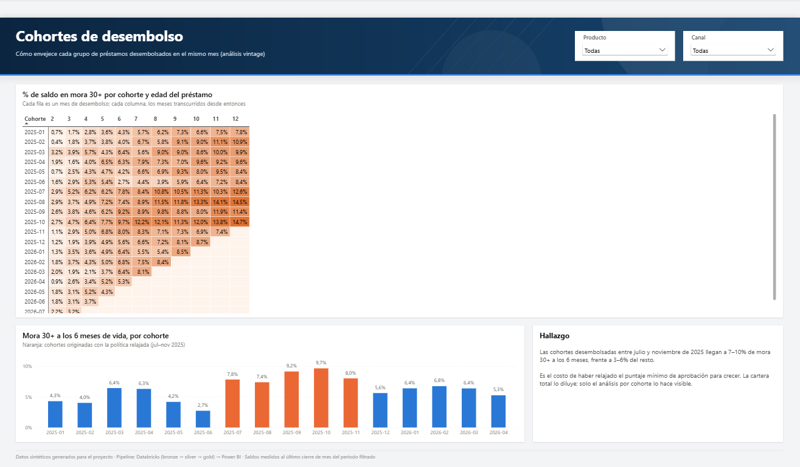
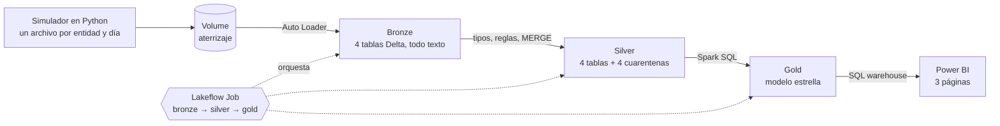
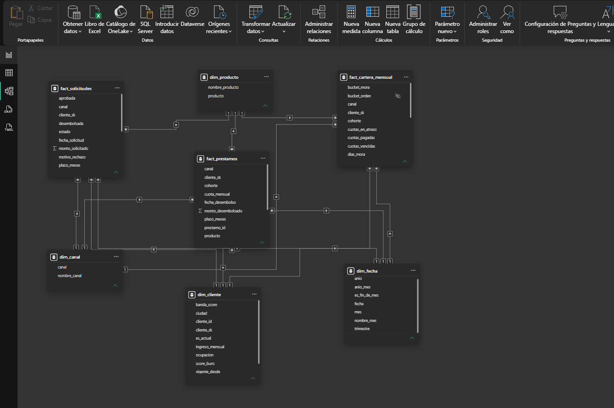
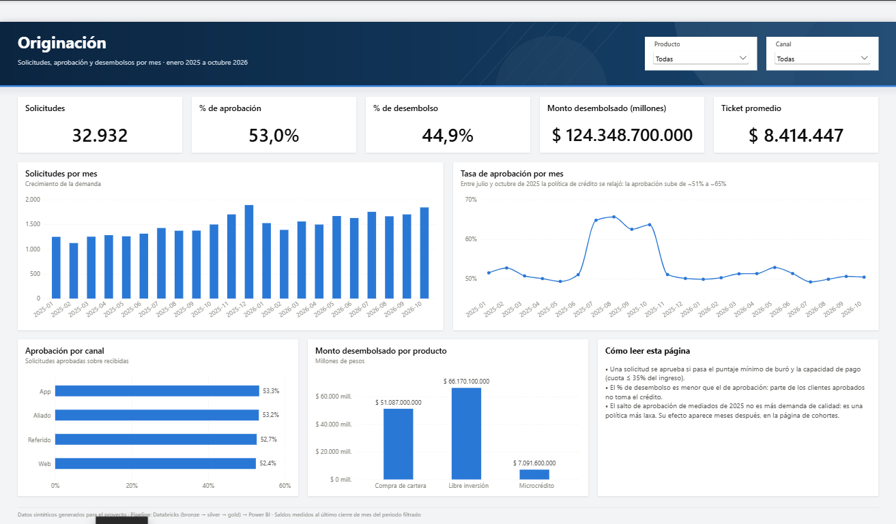
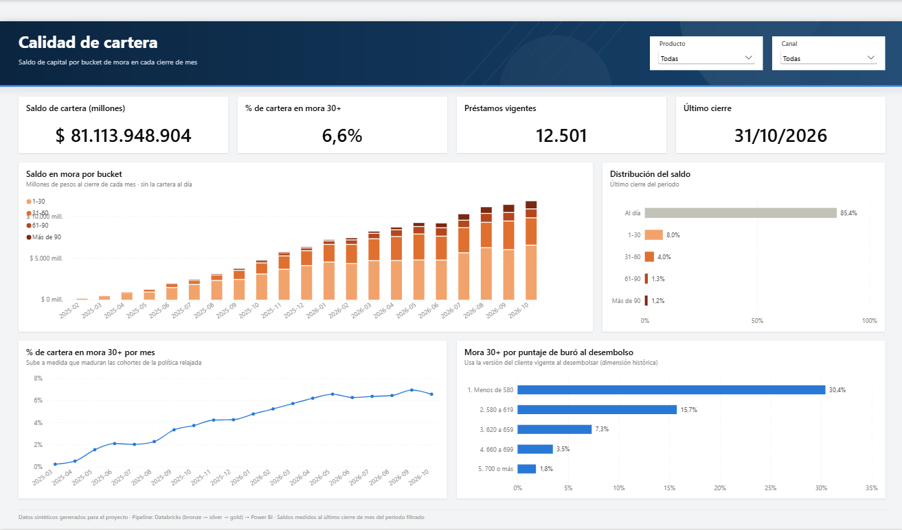

# Lakehouse de riesgo de crédito en Databricks

Pipeline de datos de punta a punta para una cartera de préstamos de consumo: ingesta incremental de archivos diarios, limpieza con cuarentena, modelo dimensional y un tablero en Power BI que responde cuánto se origina, cómo envejece cada cohorte y dónde se concentra la mora.

**Stack:** Databricks (Free Edition) · Unity Catalog · Auto Loader · PySpark · Spark SQL · Delta Lake · Lakeflow Jobs · Databricks Asset Bundles · Power BI (PBIP, DAX)



## El hallazgo

Entre julio y octubre de 2025 la política de crédito se relajó para crecer: la tasa de aprobación subió de cerca de 51% a 65%. En la cartera total el efecto casi no se nota. Por cohorte de desembolso sí se ve: los préstamos originados entre julio y noviembre de 2025 llegan a **7,4%–9,7% de saldo en mora 30+ a los 6 meses**, frente a **2,7%–6,4%** de las cohortes anteriores.

> Los datos son sintéticos (ver [Datos](#datos)). El efecto de la política se sembró en el simulador a propósito, para que el análisis tenga algo real que encontrar.

## Arquitectura



| Capa | Qué hace | Notebook |
|---|---|---|
| Aterrizaje | ≈2.650 archivos diarios (JSON y CSV) de clientes, solicitudes, préstamos y pagos, de enero de 2025 a octubre de 2026 | — |
| Bronze | Carga incremental con Auto Loader. Guarda los datos tal como llegan, más el archivo de origen y la hora de carga | [01_bronze](notebooks/01_bronze.ipynb) |
| Exploración | Perfilado de Bronze para encontrar los defectos de calidad antes de diseñar Silver | [02_exploracion](notebooks/02_exploracion.ipynb) |
| Silver | Tipos reales, normalización, reglas de calidad, cuarentena, deduplicación y carga idempotente con `MERGE` | [03_silver](notebooks/03_silver.ipynb) |
| Gold | Modelo dimensional: dimensión de clientes histórica (SCD tipo 2), tres tablas de hechos y la foto mensual de la cartera | [04_gold](notebooks/04_gold.ipynb) |
| Orquestación | Job de tres tareas con dependencias, definido como código en un Databricks Asset Bundle | [job](resources/riesgo_credito_diario.job.yml) |
| Consumo | Modelo semántico y reporte de Power BI guardados como proyecto (`.pbip`) | [powerbi/](powerbi/) |

Las capturas de cada etapa (Volume, tablas por capa, cuarentena, linaje y ejecuciones del job) están en [docs/capturas/](docs/capturas/).

## Decisiones técnicas

**Ingesta incremental real.** El simulador entrega un archivo nuevo por entidad cada día, en vez de un único archivo histórico. Auto Loader guarda en un checkpoint qué archivos ya procesó: si se vuelven a subir todos, solo carga los nuevos. Con `trigger(availableNow=True)` procesa lo pendiente y se detiene, así que corre por lotes dentro del job sin dejar un clúster encendido.

**Bronze no limpia nada.** Todas las columnas entran como texto (`inferColumnTypes = false`) y se agregan `_archivo_origen` e `_ingerido_en`. Si una regla de Silver cambia, se puede reprocesar desde Bronze sin volver a pedir los datos a la fuente.

**Calidad de datos con cuarentena, no con borrado.** Antes de diseñar Silver se perfiló Bronze. Cada defecto encontrado tiene un tratamiento:

| Defecto en la fuente | Tratamiento en Silver |
|---|---|
| Canal escrito con mayúsculas, minúsculas y espacios distintos | Normalizar (`trim` y `upper`) |
| Pagos y solicitudes que llegan dos veces | Deduplicar por clave con `ROW_NUMBER` |
| Montos vacíos o negativos | Cuarentena |
| Códigos de producto inválidos | Cuarentena |
| Pagos de préstamos que no existen | Cuarentena (verificado contra los préstamos válidos) |
| Puntajes de buró fuera de rango | Cuarentena |

Las filas rechazadas van a una tabla `*_cuarentena` con el motivo. Cada carga imprime la conciliación: filas en Bronze, rechazadas, duplicadas y cargadas a Silver.

**Carga idempotente.** Silver se escribe con `MERGE` por clave: el job se puede ejecutar varias veces sin duplicar filas.

**Cliente histórico (SCD tipo 2).** El puntaje, el ingreso y la ciudad de un cliente cambian con el tiempo. `dim_cliente` guarda una fila por versión con su rango de vigencia, y cada solicitud y préstamo se une a la versión vigente en su fecha. Así la mora por puntaje usa el puntaje que el cliente tenía al desembolsar, no el de hoy.

**La cartera mensual no existe en la fuente.** Nadie entrega el saldo ni los días de mora de cada préstamo a fin de mes. `fact_cartera_mensual` los reconstruye: genera una fila por préstamo y cierre de mes, cuenta las cuotas pagadas hasta esa fecha contra las vencidas, calcula los días de mora desde la cuota impaga más antigua y el saldo de capital con la fórmula de amortización de cuota fija. Durante el desarrollo, el resultado se verificó fila por fila contra un cálculo independiente en pandas.

**Medidas semiaditivas en Power BI.** El saldo es una foto: no se suma entre meses. `Saldo cartera` toma solo el último cierre del período filtrado; la misma medida funciona en la matriz de cohortes, donde cada celda corresponde a un único cierre.

**Origen parametrizado.** Las consultas de Power BI leen el servidor, la ruta del warehouse, el catálogo y el esquema desde parámetros de Power Query. Apuntar el reporte a otro workspace o entorno no requiere editar ninguna consulta.

**Todo como código.** El job vive en `resources/` y se despliega con `databricks bundle deploy`; el modelo semántico (TMDL) y el reporte (PBIR) de Power BI son archivos de texto versionados en Git.

## Modelo dimensional

| Tabla | Grano | Filas |
|---|---|---|
| `fact_solicitudes` | Una solicitud de crédito | 32.932 |
| `fact_prestamos` | Un préstamo desembolsado | 14.778 |
| `fact_cartera_mensual` | Un préstamo en un cierre de mes (snapshot periódico) | 147.558 |
| `dim_cliente` | Una versión de un cliente (SCD tipo 2) | 32.037 |
| `dim_fecha`, `dim_producto`, `dim_canal` | Un día, un producto, un canal | 730 / 3 / 4 |



## El tablero

| Página | Qué responde |
|---|---|
| **Originación** | Solicitudes, tasa de aprobación y desembolsos por mes, canal y producto |
| **Cohortes** | Matriz de vintages: % de saldo en mora 30+ por mes de desembolso y edad del préstamo |
| **Cartera** | Saldo por bucket de mora en cada cierre, evolución de la mora 30+ y mora por puntaje de buró |

Algunas cifras al 31 de octubre de 2026: 32.932 solicitudes con 53,0% de aprobación, 6,6% de la cartera en mora 30+, y una mora 30+ de 30,4% en clientes con puntaje menor a 580 frente a 1,8% en los de 700 o más.

| Originación | Cartera |
|---|---|
|  |  |

## Cómo ejecutarlo

Requisitos: una cuenta de [Databricks Free Edition](https://www.databricks.com/learn/free-edition), la [CLI de Databricks](https://docs.databricks.com/aws/en/dev-tools/cli/install), Python 3.10+ con `numpy` y `pandas`, y Power BI Desktop.

1. **Conectar la CLI** a tu workspace:

   ```bash
   databricks auth login --host https://<tu-workspace>.cloud.databricks.com
   ```

2. **Crear los esquemas y los Volumes:** ejecuta [`sql/00_configuracion.sql`](sql/00_configuracion.sql) en el SQL Editor.

3. **Generar los archivos diarios y subirlos** al Volume de aterrizaje:

   ```bash
   python datos/generar_datos.py --hasta 2026-10-31
   databricks fs cp -r datos/salida dbfs:/Volumes/workspace/riesgo_bronze/aterrizaje --overwrite
   ```

   Para ver la carga incremental, genera primero una fecha anterior (por ejemplo `--hasta 2025-03-31`), ejecuta el job y luego repite con una fecha posterior: solo se cargan los archivos nuevos.

4. **Desplegar y ejecutar el job:**

   ```bash
   databricks bundle deploy
   databricks bundle run riesgo_credito_diario
   ```

5. **Abrir el tablero:** abre `powerbi/Riesgo Credito.pbip`, en **Transform data > Manage parameters** pon tu `ServidorDatabricks` y tu `RutaHttp` (están en los detalles de conexión del SQL warehouse), y actualiza. La autenticación es con un token de acceso personal.

## Datos

Todos los datos son sintéticos y los genera [`src/riesgo_credito/simulador.py`](src/riesgo_credito/simulador.py) con una semilla fija, así que cada ejecución produce exactamente los mismos archivos. El simulador modela demanda con estacionalidad, aprobación por puntaje de buró y capacidad de pago, y el comportamiento de pago cuota a cuota, con un riesgo que depende del puntaje, el canal y el producto. También introduce a propósito los defectos de calidad de la tabla anterior y la relajación de la política de crédito de mediados de 2025.

## Estructura

```
├── databricks.yml            Definición del bundle
├── resources/                Job de Databricks (tres tareas)
├── notebooks/                Bronze, exploración, Silver y Gold
├── sql/                      Configuración de esquemas y Volumes
├── src/riesgo_credito/       Simulador del sistema fuente
├── datos/                    Script para generar los archivos en local
├── powerbi/                  Modelo semántico (TMDL) y reporte (PBIR)
└── docs/capturas/            Capturas de cada etapa
```

## Autor

**Dautmer Contreras** · Data Engineer y Power BI Architect · [LinkedIn](https://www.linkedin.com/in/dautmer-contreras)
